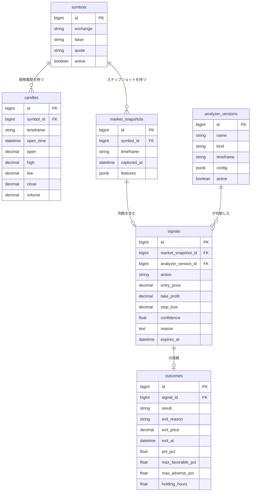

# BluePilot ドメインモデル

このドキュメントは「**何が存在し、どう繋がっているか**」を定義します。

- [vision.md](./vision.md) … なぜ作るか（目的・理念）
- **domain-model.md（このファイル）** … どう作るか（構造・データ・判断根拠）

実装より先にここで合意し、以降の実装はこのドキュメントを正とします。

---

## 1. コアサイクル

BluePilot の背骨となる繰り返しです。各ステップで必ずデータが1つ生まれます。

```
① OHLCV 取得 ────────────────→ candles
        ↓
② 指標を計算（RSI/ATR/MACD…）
        ↓
③ AI が判断 ─────────────────→ market_snapshots（見た値を凍結）
        ↓                      signals（判断・理由）
④ 一定期間後に勝敗を判定 ──────→ outcomes（成績）
        ↓
⑤ 成績を次の判断へ還元（学習・改善）
        ↓
      ①へ戻る
```

重要な性質:

- **売買したかどうかに関係なく、すべての判断を記録する**（No Action も含む）
- **判断の根拠（見た数値・理由）を必ず残す**。後から検証できない記録は価値がない

---

## 2. 登場人物（エンティティ）

| エンティティ | 役割 | ひとことで言うと |
|---|---|---|
| `symbols` | 銘柄マスタ | 何を対象にするか（例: binance BTC/USDT） |
| `candles` | 生の OHLCV | **唯一の真実**。ここから全部導ける |
| `market_snapshots` | 判断時に AI が見た指標一式 | **証拠**。後から書き換わってはいけない |
| `signals` | AI の判断 | Buy / Sell / No Action ＋ 理由 |
| `outcomes` | 判断の成績 | 勝ったか負けたか、どれだけ動いたか |
| `analyzer_versions` | 判断手法のバージョン | どの版が良かったかを比較するため |

---

## 3. ER 図



---

## 4. エンティティ詳細

### 4.1 `symbols` — 銘柄

| カラム | 型 | 説明 |
|---|---|---|
| `exchange` | string | 取引所（`binance`） |
| `base` / `quote` | string | `BTC` / `USDT` |
| `active` | boolean | 収集対象か |

制約: `unique(exchange, base, quote)`

初期は **binance BTC/USDT の1銘柄**から。銘柄を増やすとサンプルが増え、検証が速くなる。

---

### 4.2 `candles` — ローソク足（唯一の真実）

| カラム | 型 | 説明 |
|---|---|---|
| `timeframe` | string | `1h`（保存はこれ。4h は合成する → §5.2） |
| `open_time` | datetime | 足の開始時刻（**UTC**） |
| `open` / `high` / `low` / `close` | decimal | 価格 |
| `volume` | decimal | 出来高 |

制約: `unique(symbol_id, timeframe, open_time)`

- **価格は必ず `decimal`**。`float` は誤差が出るため金額に使わない
- unique 制約により、**同じ足を何度取得しても壊れない**（冪等）
- **確定した足のみ保存する**（→ §5.4）

---

### 4.3 `market_snapshots` — 判断時に見た指標（凍結記録）

| カラム | 型 | 説明 |
|---|---|---|
| `timeframe` | string | 判断に使った足（`4h`） |
| `captured_at` | datetime | 判断時刻（＝使った足の確定時刻） |
| `features` | jsonb | 指標一式 |

制約: `unique(symbol_id, timeframe, captured_at)`

`features` の例:

```json
{
  "close": 1002500.0,
  "rsi_14": 68.2,
  "macd": 1250.5,
  "macd_signal": 1100.2,
  "ma_20": 985000.0,
  "ma_200": 940000.0,
  "bb_upper_20": 1030000.0,
  "bb_lower_20": 940000.0,
  "atr_14": 25400.0,
  "volatility_7d": 0.043
}
```

**この記録は作成後、絶対に更新しない**（理由 → §5.3）。

---

### 4.4 `signals` — AI の判断

| カラム | 型 | 説明 |
|---|---|---|
| `action` | string | `buy` / `sell` / `no_action` |
| `entry_price` | decimal | 判断時点の価格 |
| `take_profit` / `stop_loss` | decimal | 利確・損切り価格 |
| `confidence` | float | 確信度 0.0〜1.0 |
| `reason` | text | **判断理由**（vision の必須要件） |
| `expires_at` | datetime | 時間切れ期限（→ §5.5） |

- `no_action` でも**必ずレコードを作る**。「見送ったが正しかったか」も評価対象
- `market_snapshot_id` と `analyzer_version_id` を必ず持つ
  → 「**どの入力を見て、どの手法が、そう判断したか**」が後から完全に追跡できる

---

### 4.5 `outcomes` — 成績

| カラム | 型 | 説明 |
|---|---|---|
| `result` | string | `win` / `loss` / `draw` |
| `exit_reason` | string | `take_profit` / `stop_loss` / `timeout` |
| `exit_price` / `exit_at` | decimal / datetime | 決済価格・時刻 |
| `pnl_pct` | float | 損益率（%） |
| `max_favorable_pct` | float | 最大含み益（MFE） |
| `max_adverse_pct` | float | 最大含み損（MAE） |
| `holding_hours` | float | 保有時間 |

制約: `unique(signal_id)`（1シグナルにつき1成績）

MFE / MAE を持つ理由: 勝敗だけでは「際どく勝った」「大きく含み損を抱えた末に勝った」が区別できない。**リスク管理を優先する**という理念には、この情報が要る。

---

### 4.6 `analyzer_versions` — 判断手法のバージョン

| カラム | 型 | 説明 |
|---|---|---|
| `name` | string | 例: `baseline-v1`, `lgbm-v3` |
| `kind` | string | `baseline` / `lightgbm` / `llm` / `external_api` |
| `timeframe` | string | `4h` / `1h`（比較実験のため） |
| `config` | jsonb | ハイパーパラメータ・プロンプト等 |
| `active` | boolean | 現在稼働中か |

これがあると「**v2 は v1 より本当に良くなったのか**」を成績で比較できる。改善の可視化そのもの。

---

## 5. 設計判断（なぜそうするか）

後から「なぜこうしたか」を失わないための記録です。

### 5.1 なぜ OHLCV だけ保存し、指標は保存しないのか

指標（RSI/MACD/MA/BB/ATR/ボラ）は **すべて OHLCV から計算できる導出データ**です。

| データ | 性質 | 保存 |
|---|---|---|
| OHLCV | 取引所から取得する事実。計算不可能 | ✅ する |
| 各種指標 | OHLCV から決定論的に計算できる | ❌ しない（都度計算） |

4h足5年で約11,000本、1h足8年でも約70,000本。**全期間の指標を再計算しても1秒かからない**規模なので、保存して同期を気にする方がコストが高い。

さらに重要な利点として、**後から「RSI(21) も試したい」と思ったときに、過去に遡って全部計算できる**。vision の「人間が指標を決めつけず、多くの情報を AI へ渡す」がそのまま実現できる。

### 5.2 なぜ 1h 足を保存して 4h 足を合成するのか

判断は 4h 足で行うが、**保存は 1h 足**にする。理由は勝敗判定の精度。

4h 足だけだと、こういうケースが判定不能になる:

```
4h足: high が take_profit に到達、low が stop_loss にも到達
     → どちらが先に起きたか分からない → 勝敗が決まらない
```

1h 足があれば順序を追える:

```
04:00-05:00  high 101  low  99
05:00-06:00  high 102  low  97   ← stop_loss ヒット。負けで確定
06:00-07:00  high 106  low 100   ← take_profit 到達だが決済済み
```

ここを曖昧にして楽観的に埋めると、**バックテストの成績だけが良く見えて実運用で負ける**。成績を正しく測れなければフィードバックのループ自体が嘘になる。

4h 足の合成は単純:

```
Open   = 4本の最初の Open
High   = 4本の max(High)
Low    = 4本の min(Low)
Close  = 4本の最後の Close
Volume = 4本の合計
```

副次的な利点として、将来 1h 足で判断したくなってもデータを取り直す必要がない。

### 5.3 なぜスナップショットを凍結するのか

指標の計算式を後から修正すると、**過去の指標値がすべて変わる**。

```
1月: AI は rsi_14 = 70 を見て buy と判断した
2月: 計算式のバグを修正 → 同じ時点が rsi_14 = 65 になる
     → 「なぜ buy したのか」が永久に検証不能になる
```

そのため `market_snapshots` は**追記のみ・更新なし**とする。これが vision の「判断理由も必ず保存する」の実体。

### 5.4 なぜ「確定した足」しか使わないのか

現在進行中の足（未確定足）は、High / Low / Close がこれから変わる。

```
14:30 時点の「12:00〜16:00 の足」はまだ確定していない
→ これを判断に使うと、バックテスト（確定足しか見えない）と本番が乖離する
```

対策として、足の確定時刻の**数分後**にジョブを回し、直前の確定足までを使う。

### 5.5 なぜ時間切れバリアが必要か

take_profit にも stop_loss にも当たらないシグナルは、**放置すると永遠に決着しない**。そこで3つ目の出口を設ける（トリプルバリア法）。

```
take_profit に到達  → win
stop_loss に到達    → loss
どちらも未到達で N 本経過 → timeout（その時点の損益で判定）
```

初期値: **N = 30本（4h足で5日）**。保有期間の目安が3日〜1週間であることに対応。

### 5.6 なぜ `features` が JSONB なのか

指標は**増える前提**だから。カラムで持つとパラメータ違いで爆発する:

```
rsi_7, rsi_14, rsi_21, ma_5, ma_20, ma_50, ma_200,
bb_upper_20, bb_lower_20, atr_14, atr_21, volatility_24h, volatility_7d ...
→ 指標を1つ試すたびにマイグレーションが必要
```

JSONB なら**マイグレーション不要で指標を追加できる**。将来「この指標は確定」となったものだけ、生成カラムに昇格させればよい。

### 5.7 なぜ No Action も評価するのか

vision の基本理念そのもの。

> すべてのアラートは学習データになる。

「見送った」という判断も、正しかったか間違っていたかを評価できる。評価しなければ、AI は「何もしない」を選び続けることで成績を守れてしまう。

---

## 6. データ取得仕様

### 6.1 対象

| 項目 | 値 |
|---|---|
| 市場 | 仮想通貨（無料・24時間365日・データの穴が少ない） |
| 取引所 | Binance |
| 銘柄 | BTC/USDT（初期は1銘柄） |
| 保存する足 | **1h** |
| 判断する足 | **4h**（1h から合成） |

### 6.2 初期ロード

過去データは API のページングより**一括ダウンロードが桁違いに速い**。

```
https://data.binance.vision/    月次・日次の CSV アーカイブ
```

取得可能な範囲は実質 **2017年頃から**（Binance 開設が 2017年7月）。それ以前は流動性が低く実用に耐えない。

### 6.3 定期取得とジョブ構成

3つのジョブに分ける。役割と頻度が異なる。

| ジョブ | 頻度 | 内容 |
|---|---|---|
| **取得** | 毎時 05分 | 直前の確定 1h 足を取得・保存 |
| **分析** | 00,04,08,12,16,20時 の 05分 | 4h 足を合成 → 指標計算 → AI 判断 → signal 保存 |
| **評価** | 毎時 10分 | 未決着 signal を 1h 足で判定、決着したら outcome 保存 |

すべて **UTC** 基準。4h 足の確定時刻は `00:00 / 04:00 / 08:00 / 12:00 / 16:00 / 20:00`。

Rails では Solid Queue の recurring（`config/recurring.yml`）で定義する。

### 6.4 ウォームアップ

指標には計算に必要な本数がある。**最も長い指標の 1.5〜2倍**を確保する。

| 指標 | 必要本数（4h足） |
|---|---|
| MA200 | 200本 |
| MACD | 約26本 |
| ボリンジャー(20) | 20本 |
| RSI(14) / ATR(14) | 14本 |

→ MA200 を使うなら **4h 足で 300本以上（＝1h 足で 1,200本以上）** を保持する。

---

## 7. Analyzer 境界

「AI 分析」は**差し替え可能な境界**とする。手法を今決め打ちしないため。

```
Analyzer（インターフェース）
   入力: MarketSnapshot
   出力: action / take_profit / stop_loss / confidence / reason

   ├─ BaselineAnalyzer     … ルールベース。動作確認と比較基準
   ├─ LightGbmAnalyzer     … 過去データで学習したモデル
   ├─ LlmAnalyzer          … LLM に判断させる
   └─ ExternalApiAnalyzer  … 外部予測 API
```

**どれを選んでも、上流（candles / market_snapshots）と下流（signals / outcomes）は変わらない。**

複数の Analyzer を**同時に走らせて成績を比較できる**（`analyzer_versions` に紐づくため）。タイムフレーム（4h / 1h）すら比較対象にできる。決め打ちせず、データに選ばせる。

### take_profit / stop_loss の初期方針

固定幅ではなく **ATR 基準**にする。相場が荒れている時は自動的に広がり、静かな時は狭くなるため、保有期間が安定する。

```
stop_loss   = entry - 2 × ATR(14)
take_profit = entry + 3 × ATR(14)     （リスクリワード 1 : 1.5）
```

※ sell の場合は符号が逆。この係数自体も `analyzer_versions.config` で管理し、検証対象とする。

---

## 8. 検証サイクルの見通し

期待値を明示しておく。

```
1日6回の分析 → エントリー相当は 1〜2件/日（AI が選別するため）
1ヶ月       → 30〜50 シグナル
統計的に意味を持つ → 最低30件、できれば100件以上
```

**最初のまともな評価ができるのは 1〜3ヶ月後**。vision の「十分な検証期間を経て、一定以上の成績が確認できた場合のみ自動売買へ移行する」は、この時間感覚に対応している。

---

## 9. 用語集

| 用語 | 意味 |
|---|---|
| OHLCV | Open / High / Low / Close / Volume。ローソク足の生データ |
| timeframe | 足の期間（`1h`, `4h`） |
| 確定足 | 期間が終了して値が変わらなくなった足 |
| ウォームアップ | 指標計算に必要な過去本数 |
| トリプルバリア | 利確・損切り・時間切れの3つで決着させる評価法 |
| MFE | Maximum Favorable Excursion。最大含み益 |
| MAE | Maximum Adverse Excursion。最大含み損 |
| Analyzer | 判断ロジックの差し替え可能な単位 |

---

## 10. このドキュメントの扱い

- 実装より先にここを更新し、合意してから書く
- 設計判断を変えるときは §5 に**理由ごと**追記する（決定の履歴を残す）
- 実装が乖離したら、どちらが正しいかを判断してどちらかを直す
