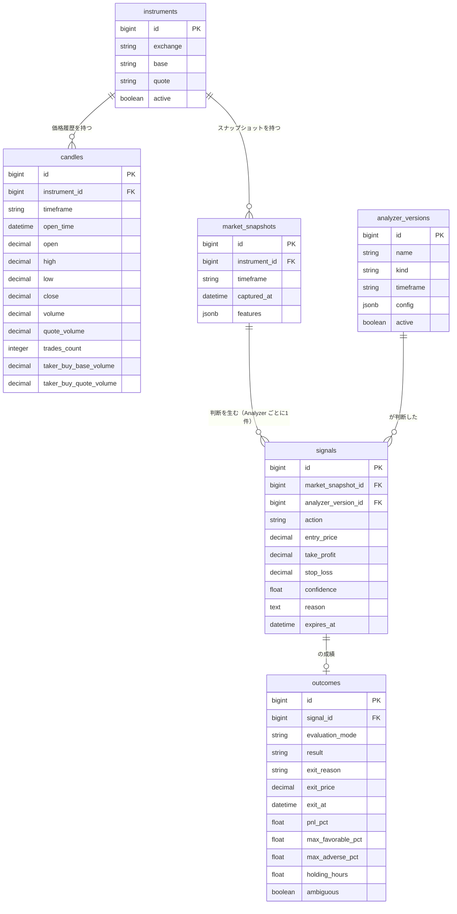

# BluePilot ドメインモデル

このドキュメントは「**何が存在し、どう繋がっているか**」を定義します。

- [vision.md](./vision.md) … なぜ作るか（目的・理念）
- **domain-model.md（このファイル）** … どう作るか（構造・データ・判断根拠）

実装より先にここで合意し、以降の実装はこのドキュメントを正とします。

---

## 1. コアサイクル

BluePilot の背骨となる繰り返しです。各ステップで必ずデータが1つ生まれます。

```
① OHLCV 取得 ────────────────→ candles
        ↓
② 指標を計算（RSI/ATR/MACD…）
        ↓
③ AI が判断 ─────────────────→ market_snapshots（見た値を凍結）
        ↓                      signals（判断・理由）
④ 一定期間後に勝敗を判定 ──────→ outcomes（成績）
        ↓
⑤ 成績を次の判断へ還元（学習・改善）
        ↓
      ①へ戻る
```

重要な性質:

- **売買したかどうかに関係なく、すべての判断を記録する**（No Action も含む）
- **判断の根拠（見た数値・理由）を必ず残す**。後から検証できない記録は価値がない

---

## 2. 登場人物（エンティティ）

| エンティティ | 役割 | ひとことで言うと |
|---|---|---|
| `instruments` | 銘柄マスタ | 何を対象にするか（例: binance BTC/USDT） |
| `candles` | 生の OHLCV | **唯一の真実**。ここから全部導ける |
| `market_snapshots` | 判断時に AI が見た指標一式 | **証拠**。後から書き換わってはいけない |
| `signals` | AI の判断 | Buy / Sell / No Action ＋ 理由 |
| `outcomes` | 判断の成績 | 勝ったか負けたか、どれだけ動いたか |
| `analyzer_versions` | 判断手法のバージョン | どの版が良かったかを比較するため |

---

## 3. ER 図



---

## 4. エンティティ詳細

### 4.1 `instruments` — 銘柄

| カラム | 型 | 説明 |
|---|---|---|
| `exchange` | string | 取引所（`binance`） |
| `base` / `quote` | string | `BTC` / `USDT` |
| `active` | boolean | 収集対象か |

| `market_type` | string | `perpetual` / `spot` |

制約: `unique(exchange, base, quote, market_type)`

初期は **binance BTCUSDT（perpetual）の1銘柄**から。銘柄を増やすとサンプルが増え、検証が速くなる。

テーブル名を `symbols` にしていないのは、Rails のモデル名が `Symbol` となり
**Ruby 組み込みの `Symbol` クラスと衝突する**ため。`instrument` は金融分野で
「取引される商品」を指す一般的な語で、現物と先物の両方を含められる。

---

### 4.2 `candles` — ローソク足（唯一の真実）

| カラム | 型 | 説明 |
|---|---|---|
| `timeframe` | string | `1h`（保存はこれ。4h は合成する → §5.2） |
| `open_time` | datetime | 足の開始時刻（**UTC**） |
| `open` / `high` / `low` / `close` | decimal | 価格 |
| `volume` | decimal | 出来高（base 資産ベース） |
| `quote_volume` | decimal | 出来高（金額ベース） |
| `trades_count` | integer | 約定回数 |
| `taker_buy_base_volume` | decimal | 成行買いの出来高 |
| `taker_buy_quote_volume` | decimal | 成行買いの出来高（金額ベース） |

制約: `unique(instrument_id, timeframe, open_time)`

- **価格は必ず `decimal`**。`float` は誤差が出るため金額に使わない
- unique 制約により、**同じ足を何度取得しても壊れない**（冪等）
- **確定した足のみ保存する**（→ §5.4）

後半4カラムは Binance の kline レスポンスに**最初から含まれている**。追加の API コールは
不要で、保存しなければ捨てているだけになる。特に有用なのは:

- `volume ÷ trades_count` = **平均取引サイズ**。大口が動いているか小口かの判別に使える
- `taker_buy_base_volume` と `volume` の比 = **成行の買い圧力か売り圧力か**。
  通常の出来高は売買の総量なので、どちら側が積極的に叩いているかは分からない

---

### 4.3 `market_snapshots` — 判断時に見た指標（凍結記録）

| カラム | 型 | 説明 |
|---|---|---|
| `timeframe` | string | 判断に使った足（`4h`） |
| `captured_at` | datetime | 判断時刻（＝使った足の確定時刻） |
| `features` | jsonb | 指標一式 |

制約: `unique(instrument_id, timeframe, captured_at)`

`features` の例:

```json
{
  "close": 1002500.0,
  "rsi_14": 68.2,
  "macd": 1250.5,
  "macd_signal": 1100.2,
  "ma_20": 985000.0,
  "ma_200": 940000.0,
  "bb_upper_20": 1030000.0,
  "bb_lower_20": 940000.0,
  "atr_14": 25400.0,
  "volatility_7d": 0.043
}
```

**この記録は作成後、絶対に更新しない**（理由 → §5.3）。

---

### 4.4 `signals` — AI の判断

| カラム | 型 | 説明 |
|---|---|---|
| `action` | string | `buy` / `sell` / `no_action` |
| `entry_price` | decimal | 判断時点の価格 |
| `take_profit` / `stop_loss` | decimal | 利確・損切り価格 |
| `confidence` | float | 確信度 0.0〜1.0 |
| `reason` | text | **判断理由**（vision の必須要件） |
| `expires_at` | datetime | 時間切れ期限（→ §5.5） |

制約: `unique(market_snapshot_id, analyzer_version_id)`

- `no_action` でも**必ずレコードを作る**。「見送ったが正しかったか」も評価対象（評価方法は §5.8）
- `market_snapshot_id` と `analyzer_version_id` を必ず持つ
  → 「**どの入力を見て、どの手法が、そう判断したか**」が後から完全に追跡できる
- unique 制約を `analyzer_version_id` との複合にしている理由:
  ジョブがリトライされても重複を作らない（冪等）一方で、**同じスナップショットを複数の
  Analyzer が同時に判断できる**ようにするため（→ §7 の比較実験）。
  `market_snapshot_id` 単独の unique にすると、比較実験ができなくなる
- `no_action` の場合も `entry_price` と仮想の `take_profit` / `stop_loss` を記録する。
  記録しないと「見送りが正しかったか」を後から計算できないため（→ §5.8）

---

### 4.5 `outcomes` — 成績

| カラム | 型 | 説明 |
|---|---|---|
| `evaluation_mode` | string | `actual`（buy/sell）/ `counterfactual`（no_action）→ §5.8 |
| `hypothetical_action` | string | counterfactual 時のみ `buy` / `sell`。actual では NULL |
| `result` | string | `win` / `loss` / `draw` |
| `exit_reason` | string | `take_profit` / `stop_loss` / `timeout` |
| `exit_price` / `exit_at` | decimal / datetime | 決済価格・時刻 |
| `pnl_pct` | float | 損益率（%） |
| `max_favorable_pct` | float | 最大含み益（MFE） |
| `max_adverse_pct` | float | 最大含み損（MAE） |
| `holding_hours` | float | 保有時間 |
| `ambiguous` | boolean | 同一足内で tp/sl 両方に到達し、順序が判別できなかった（→ §5.9） |

制約: `unique(signal_id, hypothetical_action)`

buy / sell のシグナルは `hypothetical_action` が NULL なので実質 1 シグナル 1 成績。
`no_action` のみ buy 想定・sell 想定の 2 件を持つ（→ §5.8）。

MFE / MAE を持つ理由: 勝敗だけでは「際どく勝った」「大きく含み損を抱えた末に勝った」が区別できない。**リスク管理を優先する**という理念には、この情報が要る。

---

### 4.6 `analyzer_versions` — 判断手法のバージョン

| カラム | 型 | 説明 |
|---|---|---|
| `name` | string | 例: `baseline-v1`, `lgbm-v3` |
| `kind` | string | `baseline` / `lightgbm` / `llm` / `external_api` |
| `timeframe` | string | `4h` / `1h`（比較実験のため） |
| `config` | jsonb | ハイパーパラメータ・プロンプト等 |
| `active` | boolean | 現在稼働中か |

これがあると「**v2 は v1 より本当に良くなったのか**」を成績で比較できる。改善の可視化そのもの。

---

## 5. 設計判断（なぜそうするか）

後から「なぜこうしたか」を失わないための記録です。

### 5.1 なぜ指標を保存しないのか

**この原則が適用されるのは「指標」だけ**である。OHLCV から計算できないデータ
（Funding Rate / Open Interest など → §6.5）は、取得して保存しなければ二度と手に入らない。

指標（RSI/MACD/MA/BB/ATR/ボラ）は **すべて OHLCV から計算できる導出データ**である。

| データ | 性質 | 保存 |
|---|---|---|
| OHLCV | 取引所から取得する事実。計算不可能 | ✅ する |
| 各種指標 | OHLCV から決定論的に計算できる | ❌ しない（都度計算） |
| Funding / OI / L-S Ratio | **市場の内部状態。価格からは導出不可能** | ✅ する（→ §6.5） |

4h足5年で約11,000本、1h足8年でも約70,000本。**全期間の指標を再計算しても1秒かからない**規模なので、保存して同期を気にする方がコストが高い。

さらに重要な利点として、**後から「RSI(21) も試したい」と思ったときに、過去に遡って全部計算できる**。vision の「人間が指標を決めつけず、多くの情報を AI へ渡す」がそのまま実現できる。

### 5.2 なぜ 1h 足を保存して 4h 足を合成するのか

判断は 4h 足で行うが、**保存は 1h 足**にする。理由は勝敗判定の精度。

4h 足だけだと、こういうケースが判定不能になる:

```
4h足: high が take_profit に到達、low が stop_loss にも到達
     → どちらが先に起きたか分からない → 勝敗が決まらない
```

1h 足があれば順序を追える:

```
04:00-05:00  high 101  low  99
05:00-06:00  high 102  low  97   ← stop_loss ヒット。負けで確定
06:00-07:00  high 106  low 100   ← take_profit 到達だが決済済み
```

ここを曖昧にして楽観的に埋めると、**バックテストの成績だけが良く見えて実運用で負ける**。成績を正しく測れなければフィードバックのループ自体が嘘になる。

4h 足の合成は単純:

```
Open   = 4本の最初の Open
High   = 4本の max(High)
Low    = 4本の min(Low)
Close  = 4本の最後の Close
Volume = 4本の合計
```

副次的な利点として、将来 1h 足で判断したくなってもデータを取り直す必要がない。

### 5.3 なぜスナップショットを凍結するのか

指標の計算式を後から修正すると、**過去の指標値がすべて変わる**。

```
1月: AI は rsi_14 = 70 を見て buy と判断した
2月: 計算式のバグを修正 → 同じ時点が rsi_14 = 65 になる
     → 「なぜ buy したのか」が永久に検証不能になる
```

そのため `market_snapshots` は**追記のみ・更新なし**とする。これが vision の「判断理由も必ず保存する」の実体。

### 5.4 なぜ「確定した足」しか使わないのか

現在進行中の足（未確定足）は、High / Low / Close がこれから変わる。

```
14:30 時点の「12:00〜16:00 の足」はまだ確定していない
→ これを判断に使うと、バックテスト（確定足しか見えない）と本番が乖離する
```

対策として、足の確定時刻の**数分後**にジョブを回し、直前の確定足までを使う。

### 5.5 なぜ時間切れバリアが必要か

take_profit にも stop_loss にも当たらないシグナルは、**放置すると永遠に決着しない**。そこで3つ目の出口を設ける（トリプルバリア法）。

```
take_profit に到達  → win
stop_loss に到達    → loss
どちらも未到達で N 本経過 → timeout（その時点の損益で判定）
```

初期値: **N = 30本（4h足で5日）**。保有期間の目安が3日〜1週間であることに対応。

### 5.6 なぜ `features` が JSONB なのか

指標は**増える前提**だから。カラムで持つとパラメータ違いで爆発する:

```
rsi_7, rsi_14, rsi_21, ma_5, ma_20, ma_50, ma_200,
bb_upper_20, bb_lower_20, atr_14, atr_21, volatility_24h, volatility_7d ...
→ 指標を1つ試すたびにマイグレーションが必要
```

JSONB なら**マイグレーション不要で指標を追加できる**。将来「この指標は確定」となったものだけ、生成カラムに昇格させればよい。

### 5.7 なぜ No Action も評価するのか

vision の基本理念そのもの。

> すべてのアラートは学習データになる。

「見送った」という判断も、正しかったか間違っていたかを評価できる。評価しなければ、AI は「何もしない」を選び続けることで成績を守れてしまう。

### 5.8 No Action をどう評価するか

`no_action` には実際の tp/sl が存在しないため、そのままでは §4.5 の評価軸に乗らない。
そこで **反実仮想（counterfactual）** で評価する。

1. `no_action` のシグナルにも、**仮に入っていたら**の `entry_price` / `take_profit` / `stop_loss` を記録しておく
2. 評価時は、buy/sell と**まったく同じロジック**で「もし入っていたらどうなったか」を計算する
3. `outcomes.evaluation_mode = counterfactual` として保存する

**buy 方向と sell 方向の両方を評価する。** 対象は先物（→ §6.1）でショートも正規の
判断肢であるため、buy 方向だけを検証すると「本当は sell すべきだったのに見送った」
ケースを機会損失として検出できず、見送りの精度が buy 側に偏る。

そのため `no_action` の場合は **counterfactual の outcome を 2 件**（buy 想定・sell 想定）作る。
`outcomes` に `hypothetical_action`（`buy` / `sell`）を持たせて区別する。
`unique(signal_id)` は `unique(signal_id, hypothetical_action)` に緩める
（`actual` の場合は `hypothetical_action` を NULL とし、1 件のみ）。

判定は次のようになる:

| buy 想定 | sell 想定 | 見送りの評価 |
|---|---|---|
| loss | loss | ✅ 正しい（どちらに入っても負けていた） |
| win | loss | ❌ 機会損失（buy すべきだった） |
| loss | win | ❌ 機会損失（sell すべきだった） |
| win | win | 起こりえない（tp/sl が対称なら両建てで両方勝つことはない） |

解釈は反転する:

| `evaluation_mode` | `result` | 意味 |
|---|---|---|
| `actual` | `win` | 実際に入って勝った → 判断は正しい |
| `actual` | `loss` | 実際に入って負けた → 判断は誤り |
| `counterfactual` | `loss` | 入っていたら負けていた → **見送りは正しい** |
| `counterfactual` | `win` | 入っていたら勝てていた → **見送りは誤り（機会損失）** |

この方式の利点:

- 評価ロジックが1本で済む（buy/sell と no_action で分岐しない）
- `outcomes` のスキーマが統一され、集計クエリが単純になる
- 「見送りの精度」を勝率と同じ土俵で測れる

なお `evaluation_mode` は成績集計時に**必ず分けて扱う**こと。混ぜると実際の損益が歪む。

### 5.9 tp と sl の順序が判別できない場合

保存する足（1h）より細かい値動きは記録されていないため、**同一足内で tp と sl の両方に
到達したケースでは順序が判別できない**。

```
1h足: 高値が take_profit を超え、安値が stop_loss を割っている
      → どちらが先に起きたか不明
```

**ルール: 判別できない場合は `loss` として扱い、`ambiguous = true` を立てる。**

悲観的に倒す理由:

- 楽観的に処理すると成績が実際より良く見え、**使えない戦略を採用してしまう**
- vision の「利益よりもリスク管理を優先する」に沿う
- `ambiguous` フラグを立てておけば、後から発生頻度を集計して影響を測れる

発生頻度は tp/sl の幅に依存する。現在の設定（tp-sl 間が約 5×ATR ≒ 5〜7%）では
1h 足で年に数回程度と見込まれるが、**将来 tp/sl を狭めると頻度が上がる**。
`ambiguous` の比率が無視できなくなったら、より細かい足（15m 等）の保存を検討する。
その際は Binance のアーカイブから再取得すればよく、作り直しは初期ロードジョブの再実行で済む。

### 5.10 ファンダメンタル情報を現時点でスコープ外とする理由

vision.md §2 では、ニュース・経済イベント・規制情報などもAIへ渡す方針が示されている。
これは最終的な目標として維持するが、**初期スコープには含めない**。

理由:

| 課題 | 内容 |
|---|---|
| サンプル数 | 主要ニュースは8年でも数十件。統計的な学習が成立せず過学習する |
| point-in-time | ニュースAPIは記事を後から追加・修正することがあり、「当時知り得なかった情報」で学習してしまう危険がある。OHLCV にはこの問題がない |
| 速度 | 重要ニュースは数秒で織り込まれる。定期ジョブでは間に合わない |
| コスト | 履歴付きの良質なAPIは高価。無料のものは過去アーカイブがなく学習に使えない |

**モデルへ投入する優先順位**:

1. **OHLCV のみ** ← まずここでベースラインを確立する
2. Funding Rate / Open Interest / Long-Short Ratio（無料・数値・価格と独立）
3. Fear & Greed Index（無料・日次。ただし算出根拠に価格由来の要素が含まれるため、
   テクニカル指標と情報が一部重複する）
4. ニュース系（費用対効果が最も低い）

**ベースラインなしに情報を追加してはいけない。** 比較対象がなければ「効いたかどうか」を
判定できず、vision の「データで判断する」が成立しなくなるため。

⚠️ **投入の優先順位と、収集の優先順位は別**である。
Open Interest / Long-Short Ratio は遡って取得できないため（→ §6.5）、
モデルに投入するのが 2 番目であっても、**収集は最初から始める**必要がある。

なお Funding / OI などは candles と同様に独立した時系列であり、
`market_snapshots.features` に入れるだけでは済まず、**専用のテーブルが必要**になる。
`features` は「判断時にその値がいくつだったか」を凍結する用途に留まる。

---

## 6. データ取得仕様

### 6.1 対象

| 項目 | 値 |
|---|---|
| 市場 | 仮想通貨 |
| 取引所 | Binance |
| 商品 | **無期限先物（Perpetual）** |
| 銘柄 | BTCUSDT（初期は1銘柄） |
| 保存する足 | **1h** |
| 判断する足 | **4h**（1h から合成） |

#### なぜ仮想通貨か

- **24時間365日動く**ため、土日のギャップが存在しない。
  FX や株では週末を挟むと窓が開き、stop_loss の価格で決済できず、
  §4.5 の「バリア価格で決済される」という評価の前提が崩れる
- 価格以外に **Funding Rate / Open Interest / Long-Short Ratio** が取れる。
  これらは価格からは導出できない独立した情報で、FX には相当するものがほぼ無い
- public API が無料で、過去データの一括アーカイブも公開されている

税制面では日本の場合 FX（申告分離課税）の方が有利だが、現時点はアラートの検証段階であり、
実運用に至った時点で改めて検討する。なおドメインモデルは資産クラス非依存のため、
FX へ移す場合もデータ取得アダプタの差し替えで済む。

#### なぜ Binance か

- 取引量が世界最大で、価格の信頼性が高い
- `data.binance.vision` で**過去データを一括ダウンロードできる**（他取引所には少ない）
- public 市場データは API キー不要

#### なぜ現物ではなく先物か

- **Funding Rate / Open Interest は先物にしか存在しない**。現物を選ぶとこれらを全て失う
- 現物では空売りができず、vision の `Buy / Sell / No Action` のうち Sell が成立しない
- 値動きは現物とほぼ同一のため、分析結果は現物にも流用できる
- 先物を選んでもレバレッジは必須ではない（1 倍で扱える）

将来実際に売買する段階では、居住地の規制により**取引先が別の取引所になる可能性がある**
（日本ではデリバティブのレバレッジ上限や、利用できる取引所の制限がある）。
データ収集と売買執行は分離できるため、この設計には影響しない。

### 6.2 初期ロード

過去データは API のページングより**一括ダウンロードが桁違いに速い**。

```
https://data.binance.vision/    月次・日次の CSV アーカイブ
```

取得可能な範囲は実質 **2017年頃から**（Binance 開設が 2017年7月）。それ以前は流動性が低く実用に耐えない。

### 6.3 定期取得とジョブ構成

3つのジョブに分ける。役割と頻度が異なる。

| ジョブ | 頻度 | 内容 |
|---|---|---|
| **取得** | 毎時 05分 | 直前の確定 1h 足を取得・保存 |
| **分析** | 00,04,08,12,16,20時 の **15分** | 4h 足を合成 → 指標計算 → AI 判断 → signal 保存 |
| **評価** | 毎時 **20分** | 未決着 signal を 1h 足で判定、決着したら outcome 保存 |

すべて **UTC** 基準。4h 足の確定時刻は `00:00 / 04:00 / 08:00 / 12:00 / 16:00 / 20:00`。

実行時刻をずらしている理由は**ジョブ間のレース条件を避けるため**。分析ジョブが合成する
4h 足の最後の1本は、同じ時刻に走る取得ジョブが保存しようとしているものと同一になる。
同時刻に走らせると、**1本欠けた状態で 4h 足を合成してしまう**。

```
05分  取得   … 04:00〜05:00 の 1h 足を保存
15分  分析   … 00:00〜04:00 の 4h 足を合成（取得完了から10分の余裕）
20分  評価   … 保存済みの 1h 足で未決着 signal を判定
```

時刻をずらすだけでは不十分なので（取得が遅延・失敗する可能性がある）、
**分析ジョブは開始時に必要な 1h 足が揃っているかを検証し、欠けていれば実行せずリトライする**。
時刻の分離は一次防御、事前検証が最終防御。

Rails では Solid Queue の recurring（`config/recurring.yml`）で定義する。

### 6.4 ウォームアップ

指標には計算に必要な本数がある。**最も長い指標の 1.5〜2倍**を確保する。

| 指標 | 必要本数（4h足） |
|---|---|
| MA200 | 200本 |
| MACD | 約26本 |
| ボリンジャー(20) | 20本 |
| RSI(14) / ATR(14) | 14本 |

→ MA200 を使うなら **4h 足で 300本以上（＝1h 足で 1,200本以上）** を保持する。

### 6.5 収集対象データ一覧

判断基準は **「後から取り返せるか」**。遡って取得できないデータは、使う予定がなくても
収集だけ先に始める価値がある。収集を止めている期間は、後から埋められない。

#### 🔴 最優先 — 遡れないため今すぐ収集を開始する

Binance の先物データ系エンドポイントは**直近30日程度しか返さない**。
過ぎた分は有料アグリゲーター（Coinglass 等）から購入する以外に入手できない。

| データ | エンドポイント | 遡及 | 意味 |
|---|---|---|---|
| Open Interest | `/futures/data/openInterestHist` | ⚠️ 約30日 | 建玉残高。相場の過熱度 |
| Long/Short Ratio（全体） | `/futures/data/globalLongShortAccountRatio` | ⚠️ 約30日 | 全体のポジション偏り |
| Top Trader L/S（口座） | `/futures/data/topLongShortAccountRatio` | ⚠️ 約30日 | 大口の偏り |
| Top Trader L/S（建玉） | `/futures/data/topLongShortPositionRatio` | ⚠️ 約30日 | 大口の建玉ベース偏り |
| Taker Buy/Sell Ratio | `/futures/data/takerlongshortRatio` | ⚠️ 約30日 | 成行の買い/売り比率 |
| Liquidations | WebSocket `forceOrder` | ⚠️ 履歴なし | 強制決済。急変動の燃料 |

※ 各エンドポイントの遡及期間は変更されうるため、実装時に最新仕様を確認すること。

**Open Interest が価格と独立した情報である例:**

```
価格↑ + OI↑  → 新規の買いが入っている      → トレンドが強い
価格↑ + OI↓  → 売り方の買い戻し（撤退）     → 上昇が終わりかけ
```

この2つは OHLCV 上ではどちらも同じ陽線であり、区別できない。

#### 🟡 保存する — 遡及可能だが、保存しなければ使えない

| データ | 取得元 | 遡及 | 頻度 |
|---|---|---|---|
| OHLCV + 拡張4カラム | `/fapi/v1/klines` | ✅ 2017年〜 | 1h |
| Funding Rate | `/fapi/v1/fundingRate` | ✅ 契約開始〜 | 8時間 |
| Mark / Index Price（ベーシス） | `/fapi/v1/markPriceKlines`<br>`/fapi/v1/indexPriceKlines` | ✅ ローソク足形式で遡れる | 1h |
| Fear & Greed Index | `api.alternative.me/fng/` | ✅ 2018年〜 | 日次 |

**ベーシス**（先物価格と現物指数価格の乖離）は Funding Rate と近い情報を持つが、
Funding が8時間ごとにしか発生しないのに対し、ベーシスは**連続的に観測できる**ため
より細かい変化を捉えられる。

```
basis_pct = (mark_price - index_price) / index_price

プラスが大きい → 先物が現物より高い → 強気に傾いている（過熱）
マイナス       → 先物が現物より安い → 弱気
```

#### 🟢 保存しない — OHLCV から計算できる

RSI / MACD / 移動平均 / ボリンジャーバンド / ATR / ボラティリティ /
ストキャスティクス / OBV / VWAP / ADX ほか、指標は全て該当（→ §5.1）。

#### ⚪ 将来検討

| データ | 取得元 | 備考 |
|---|---|---|
| オンチェーン（取引所入出金・アクティブアドレス等） | Glassnode / CryptoQuant | 有料傾向 |
| マクロ（DXY / S&P500 / 金利） | yfinance 等 | 無料・履歴あり。**遡れるので急がない** |
| ニュース・イベント | 各種ニュースAPI | 優先度最低（→ §5.10） |

#### データ量の見積もり（1銘柄・年間）

| データ | 頻度 | 行数/年 |
|---|---|---|
| candles (1h) | 毎時 | 8,760 |
| Funding Rate | 8時間 | 1,095 |
| Open Interest | 毎時 | 8,760 |
| L/S Ratio × 4種 | 毎時 | 35,040 |
| ベーシス（mark/index） | 毎時 | 8,760 |
| Fear & Greed | 日次 | 365 |
| **合計** | | **約 62,000 行/年** |

10年蓄積しても約45万行であり、PostgreSQL にとって負荷にならない。

#### 溜めることと、モデルに入れることは別

vision.md は「できるだけ多くの情報を AI へ渡す」方針を掲げているが、
統計上の制約として、学習データ 17,000 本（4h・8年）に対して特徴量を数百個入れれば
**ノイズを学習して過学習する**。適正はおよそ 20〜50 特徴量。

両者は次のように切り分けることで両立する。

```
保存 … 最大限に溜める（溜めなければ後から選ぶことすらできない）
投入 … 厳選する（特徴量重要度で絞り、追加は必ずベースラインと比較する）
```

---

## 7. Analyzer 境界

「AI 分析」は**差し替え可能な境界**とする。手法を今決め打ちしないため。

```
Analyzer（インターフェース）
   入力: MarketSnapshot
   出力: action / take_profit / stop_loss / confidence / reason

   ├─ BaselineAnalyzer     … ルールベース。動作確認と比較基準
   ├─ LightGbmAnalyzer     … 過去データで学習したモデル
   ├─ LlmAnalyzer          … LLM に判断させる
   └─ ExternalApiAnalyzer  … 外部予測 API
```

**どれを選んでも、上流（candles / market_snapshots）と下流（signals / outcomes）は変わらない。**

複数の Analyzer を**同時に走らせて成績を比較できる**（`analyzer_versions` に紐づくため）。タイムフレーム（4h / 1h）すら比較対象にできる。決め打ちせず、データに選ばせる。

### take_profit / stop_loss の初期方針

固定幅ではなく **ATR 基準**にする。相場が荒れている時は自動的に広がり、静かな時は狭くなるため、保有期間が安定する。

```
stop_loss   = entry - 2 × ATR(14)
take_profit = entry + 3 × ATR(14)     （リスクリワード 1 : 1.5）
```

※ sell の場合は符号が逆。この係数自体も `analyzer_versions.config` で管理し、検証対象とする。

---

## 8. 空売り（ショート）の扱い

先物を対象とするため（→ §6.1）、`sell` は正規の判断肢とする。vision.md の
`Buy / Sell / No Action` に対応する。

利点:

- **機会がおよそ2倍**になり、シグナルが貯まる速度＝検証サイクルが速くなる
- 仮想通貨は下落局面が数ヶ月〜1年続くことがあり、ロングのみだと動けない期間が生じる
- 学習データとして上昇・下落の両パターンを含められる

### 8.1 成績は long / short を分けて集計する

```
❌ 全体の勝率 55%
✅ long 70% / short 40%  ← 分けて初めて「ショートが足を引っ張っている」と分かる
```

`signals.action` で分離できるが、**混ぜて評価してはいけない**。方向ごとに
有効な特徴量が異なる可能性があるため、改善の手がかりを失う。

### 8.2 仮想通貨には長期的な上昇バイアスがある

2017年以降、BTC は長期的に大きく上昇してきた。この期間はロングが構造的に有利であり、
ショートは逆風だった。保有期間が3〜5日であれば日々のボラティリティに比べて
長期トレンドの影響は小さいが、**成績を解釈する際は考慮する**。

### 8.3 バイ・アンド・ホールドをベンチマークとして記録する

上昇バイアスがあるため、**勝率が高いだけでは戦略に価値があるとは言えない**。

```
AI戦略の年間リターン      : +30%
同期間の BTC 保有のみ     : +80%
→ 「勝っている」ように見えて、何もしない方が良かった
```

`outcomes` の集計とあわせて、**同期間のバイ・アンド・ホールド収益を必ず併記する**。
これを超えられない限り、戦略として採用しない。

vision.md の「感覚ではなくデータで判断する」を、戦略の採否そのものに適用する。

---

## 9. 検証サイクルの見通し

期待値を明示しておく。

```
1日6回の分析 → エントリー相当は 1〜2件/日（AI が選別するため）
1ヶ月       → 30〜50 シグナル
統計的に意味を持つ → 最低30件、できれば100件以上
```

**最初のまともな評価ができるのは 1〜3ヶ月後**。vision の「十分な検証期間を経て、一定以上の成績が確認できた場合のみ自動売買へ移行する」は、この時間感覚に対応している。

---

## 10. 用語集

| 用語 | 意味 |
|---|---|
| OHLCV | Open / High / Low / Close / Volume。ローソク足の生データ |
| timeframe | 足の期間（`1h`, `4h`） |
| 確定足 | 期間が終了して値が変わらなくなった足 |
| ウォームアップ | 指標計算に必要な過去本数 |
| トリプルバリア | 利確・損切り・時間切れの3つで決着させる評価法 |
| MFE | Maximum Favorable Excursion。最大含み益 |
| MAE | Maximum Adverse Excursion。最大含み損 |
| Analyzer | 判断ロジックの差し替え可能な単位 |

---

## 11. このドキュメントの扱い

- 実装より先にここを更新し、合意してから書く
- 設計判断を変えるときは §5 に**理由ごと**追記する（決定の履歴を残す）
- 実装が乖離したら、どちらが正しいかを判断してどちらかを直す
